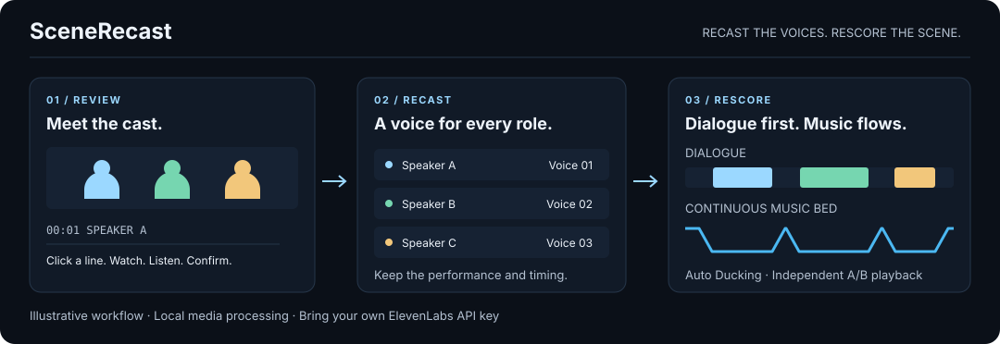
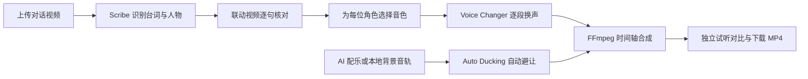

<div align="center">

# SceneRecast · 声幕

**同一场戏，全新声场。**

给视频中的每个角色重新选声，再为整场戏配乐。

*Recast the voices. Rescore the scene.*

[](LICENSE)
[](https://nodejs.org/)
[](https://www.python.org/)
[](https://ffmpeg.org/)

[快速开始](#快速开始) · [工作流程](#工作流程) · [配乐与自动混音](#配乐与自动混音) · [数据与费用](#数据与费用) · [已知边界](#已知边界)

</div>

---

**SceneRecast 是一个在本机运行的多人视频换声工具。** 上传对话视频，用 Scribe 识别台词和说话人，为每位人物选择新的音色，再通过 Voice Changer 尽量保留对白的语速、语气和表演节奏。需要配乐时，可以根据视频生成新音乐，或上传已有背景音轨，用 Auto Ducking 让音乐自动避让对白。

适合 AI 短片、古装对话、英文剧情片段，以及多角色声音设计的实验与展示。画面内容保留，声音重新编排。

> 本地运行界面与媒体处理，语音识别、变声和可选的 AI 配乐由 ElevenLabs API 提供。需要自己的 API Key，云端生成可能产生费用。



*上图为虚构角色的流程示意，不包含本地视频、真实音色 ID 或账户信息。*

## 能做什么

| 能力 | 使用体验 |
| --- | --- |
| 多人对白识别 | Scribe 词级时间戳与说话人识别，形成逐句时间轴 |
| 视频与字幕联动 | 点击整句字幕定位并播放，同时高亮对应说话人 |
| 每位角色独立选声 | 为不同人物分配不同 Voice ID，逐段转换并按原时间轴合成 |
| 我的音色 / 共享音色 | 切换账户音色与共享音色库，搜索、分页，按语言、地区和口音筛选共享音色 |
| 连续背景音乐 | Video-to-Music 生成配乐，或上传本地 MP3 / WAV / 分离后的背景音轨 |
| Auto Ducking | 复用已有混音核心，提供 dB 音量、衰减、停顿合并、渐变和手动区间 |
| 独立试听对比 | 原视频与结果并排，各自播放；启动一边会暂停另一边 |
| 项目持久保存 | 视频、片段、字幕、映射和混音设置按项目保存，服务重启后可继续 |
| 复用已生成素材 | 调节混音参数后直接重新合成，不重复生成配音或音乐 |
| 本地诊断 | 前后端日志可查看、复制和导出，常见凭据格式会脱敏 |

## 快速开始

### 1. 准备环境

| 依赖 | 要求 | 用途 |
| --- | --- | --- |
| Node.js | 22.5 或更高版本 | 本地 HTTP 服务与 API 请求 |
| Python | 3.9 或更高版本，命令为 `python3` | 原有 Auto Ducking 核心，仅使用标准库 |
| FFmpeg / FFprobe | 可在 `PATH` 中找到 | 提取、切片、响度处理和合成 |
| ElevenLabs API Key | 具备所用接口和音色的访问权限 | 转录、变声；AI 配乐为可选能力 |

macOS 使用 Homebrew 时可安装 FFmpeg：

```bash
brew install ffmpeg
```

其他系统请按 [FFmpeg 官方下载说明](https://ffmpeg.org/download.html)安装，并确认 `ffmpeg` 和 `ffprobe` 都已加入 `PATH`。

### 2. 启动

克隆或下载本仓库，进入项目目录后执行：

```bash
npm ci
npm start
```

打开 **[http://127.0.0.1:3218](http://127.0.0.1:3218)**。

项目没有第三方 npm 运行时依赖；Python 混音核心也不需要额外安装 pip 包。

### 3. 连接自己的账户

在页面中粘贴 ElevenLabs API Key，点击 **验证并连接**。

Key 只保存在当前页面内存，经本机服务转发给 ElevenLabs；刷新或关闭页面后需要重新输入。项目不会从环境变量或 `.env` 文件读取 API Key，也不会将 Key 写入项目数据或浏览器存储。

## 工作流程



1. **上传视频。** 支持 MP4、MOV、M4V、MKV、WebM，单个文件最多 500 MB、最长 10 分钟。
2. **识别并核对。** 调用 Scribe 后，点击字幕试听对应片段，通过视频确认识别结果。
3. **为人物选声。** 可以使用我的音色库、共享音色库，或手动填写 Voice ID。同一项目中的不同人物需使用不同音色。
4. **先生成并试听配音。** 开始前会提示 API 用量。完成后可逐段试听，也可播放无配乐预览视频；此时尚未生成最终成品。失败片段可以重试，已完成且音色未改变的片段会复用。
5. **再准备配乐。** 配音素材就绪后，生成新音乐或上传已有背景音轨。此步骤只保存音乐素材，不会自动合成；无需音乐可跳过。
6. **最后合成、试听与导出。** 确认“将使用的素材”摘要，调整 Auto Ducking 后点击“生成最终成品”。原片与成品独立播放；再调音量时只需重新最终合成，不用重新生成配音或音乐。

### 音色库说明

| 来源 | 接口与行为 |
| --- | --- |
| 我的音色库 | [`GET /v2/voices`](https://elevenlabs.io/docs/api-reference/voices/search)，读取当前账户可用音色 |
| 共享音色库 | [`GET /v1/shared-voices`](https://elevenlabs.io/docs/api-reference/voices/voice-library/get-shared)，支持关键词、`language`、`locale`、`accent` 筛选与分页 |
| 选择共享音色 | 先通过[添加共享音色接口](https://elevenlabs.io/docs/api-reference/voices/voice-library/share)添加到自己的账户，再绑定返回的 Voice ID；这会修改账户音色库 |

列表按每页 100 条请求，可继续加载下一页。语言和地区标签可填写 `zh`、`en`、`zh-CN`、`en-US` 等；结果取决于音色实际提供的标签。转换前还会检查目标音色的访问与验证状态，受限音色会给出错误提示。

## 配乐与自动混音

### 两种背景处理方式

| 模式 | 原音轨 | 新背景音乐 |
| --- | --- | --- |
| 原音轨模式 | 成功变声的片段内压低，默认保留 0%；其他时间保持原音量 | 不添加 |
| 新配乐模式 | 替换原背景，只在未成功变声的对白区间保留原声 | 连续铺底，说话时压低，停顿时平滑恢复 |

原音轨同时包含人声和背景时，直接降音量会一起压低它们，因此可能听到背景的起落。需要连续音乐时使用新配乐模式；需要保留原环境声时，可先用外部分离工具得到背景音轨后上传。

### 生成或上传配乐

- **生成新配乐：** 调用 [ElevenLabs Video-to-Music](https://elevenlabs.io/docs/api-reference/music/video-to-music)，使用 `music_v2_5`，请求不含演唱和对白的背景音乐。无配乐的配音预览视频会上传到 ElevenLabs，最大 200 MB。额外 SFX 默认关闭；可选择参考原音频的音乐风格。请先试听生成结果。
- **上传已有音乐：** 直接选择本地音频，最多 100 MB。音乐需覆盖视频时长；上传与混音均在本机完成，不调用 ElevenLabs。

配音生成、音乐准备和最终合成是三个独立步骤。前两步只生成各自的素材，最终合成才会融合它们。更换配音、音乐或混音设置后，旧成品会标记为待更新，避免误下载未应用新素材的版本。**改音量、合并间隔或渐变参数后，点击“应用 Auto Ducking 并重新混音”即可，不需要重新生成配乐。**

### 复用 Auto Ducking Lab

本项目直接整合已有 Auto Ducking Lab 的 [`core.py`](vendor/auto-ducking/core.py)，通过薄层 Python 适配调用其区间合并、包络和 `render_video` 混音函数。[来源与集成说明](vendor/auto-ducking/NOTICE.md)

处理时先准备换声后的对白视频，将配乐校准至 **-18 LUFS / -2 dBTP**，再交给原 Auto Ducking 核心持续播放和压低音乐，避免配乐源文件过轻、连续乘百分比后难以听见。

| 控件 | 默认值 | 作用 |
| --- | --- | --- |
| 无人讲话时的音乐基础音量 | -6 dB | 控制校准后配乐的整体音量 |
| 讲话时额外衰减 | 8 dB | 让配乐在对白下面继续播放 |
| 合并停顿阈值 | 1 秒 | 避免短停顿里音量频繁起落 |
| 降低 / 恢复音量渐变 | 150 / 550 ms | 平滑进入、退出避让区间 |
| 前后预留 | 讲话前 150 ms、后 250 ms | 覆盖对白边界 |
| 手动区间 | 可选 | 用“起点-终点”覆盖自动避让区间 |

界面会显示识别区间与合并后的 ducking 时间轴，并在合成后显示**成品是否包含新音乐、实际使用的 dB 参数**。手动区间只控制配乐避让，不会修改原字幕或重新分配说话人。

### 配合音轨分离工具

| 外部项目 | 可配合的用途 | 使用时注意 |
| --- | --- | --- |
| [Ultimate Vocal Remover GUI](https://github.com/Anjok07/ultimatevocalremovergui) | 通过桌面界面提取背景或伴奏音轨 | 分离结果可能残留对白或损失音效，先试听 |
| [Demucs](https://github.com/facebookresearch/demucs) | 音乐源分离与人声 / 伴奏分离 | 原 Meta 仓库已归档；电影对白、环境声的效果依赖素材和模型 |

推荐衔接方式：**原音轨 → 外部分离 → 试听背景音轨 → 上传到 SceneRecast → 与已生成的配音一起 Auto Ducking 混音。**

这些模型未随项目打包，也不会自动安装或运行。处理时保留背景音轨与原视频的时间对齐，并遵守工具、模型和素材各自的许可。

## 数据与费用

### 哪些内容会发送到外部

| 操作 | 发送给 ElevenLabs 的内容 | 费用与状态变化 |
| --- | --- | --- |
| 连接 / 查询音色 | API Key 和查询参数 | 用于验证访问和读取音色 |
| 选择共享音色 | 音色、公开所有者标识和名称 | 添加到自己的账户音色库 |
| 识别人物与台词 | 从视频提取的音频 | 产生转录用量 |
| 生成变声 | 对应人物的语音片段及目标 Voice ID | 产生 Voice Changer 用量 |
| 自动生成配乐 | 配音预览视频、风格描述与选项 | 产生 Music 用量 |
| 上传本地配乐 / 重新混音 | 不发送到 ElevenLabs | 本机 FFmpeg / Python 执行，无 API 生成费用 |

具体权限与计费以你的 ElevenLabs 账户为准。开始转录、变声或生成配乐前，页面会提示确认。不要提交自己无权使用的视频或音色。

### 本地保留什么

```text
storage/                           # 项目本机持久存储，整个目录被 Git 忽略
├── projects/
│   └── <project-id>/               # 每个视频独立一个项目
│       ├── job.json                # 字幕、人物映射与处理设置
│       ├── input.*                 # 原视频
│       ├── source-audio.wav        # 完整原音轨
│       ├── stt-audio.wav           # 转录音频
│       ├── segments/               # 原语音片段与 converted 变声片段
│       ├── background-music.mp3    # 可选：生成 / 上传的配乐
│       ├── background-music-normalized.wav
│       ├── dialogue-preview.mp4    # 配音阶段的无配乐预览视频
│       ├── voice-only.mp4          # 最终新配乐模式的对白中间视频
│       ├── auto-ducking-report.json
│       └── output.mp4             # 最终成品
└── logs/diagnostics.jsonl          # 本地诊断日志
```

这些文件会持久保存，关闭服务、刷新页面或更换视频不会自动删除。可以在“已保存项目”中切换；“清理本次数据”会在确认后删除当前项目文件。API Key 不写入上述数据。

升级时如果项目中只有旧版 `data/`，应用首次启动会将整个目录迁移到 `storage/`；现有项目、音视频和日志都会保留。

`storage/`、旧版遗留的 `data/`、`exports/`、`backups/` 和 `.env*` 已由 Git 忽略。**发布源码 ZIP 时也要排除这些目录，不能只依赖 `.gitignore`。** 日志对常见凭据格式做脱敏，分享诊断导出前仍应检查内容。

## 配置与常见问题

除特殊安装位置外，无需编辑配置文件。

| 环境变量 | 默认值 / 用途 |
| --- | --- |
| `VOICE_DEMO_PORT` | `3218`，本机监听端口 |
| `VOICE_DEMO_DATA_DIR` | 项目根目录的 `storage/`；自定义目录也应排除在版本管理之外 |
| `FFMPEG_PATH` / `FFPROBE_PATH` | 可执行文件完整路径；默认自动查找 `PATH` 和常见安装目录 |
| `PYTHON_PATH` | `python3`，Auto Ducking 使用的 Python 可执行文件 |
| `ELEVENLABS_BASE_URL` | `https://api.elevenlabs.io`；仅在明确需要其他 API 地址时更改，Key 会发送到该地址 |

应用不加载 `.env`。需要设置变量时，在启动进程前通过 shell 或操作系统设置，例如 macOS / Linux：

```bash
VOICE_DEMO_PORT=3219 npm start
```

<details>
<summary>提示找不到 FFmpeg / FFprobe 或 Python</summary>

先确认以下命令可运行：

```bash
node --version
python3 --version
ffmpeg -version
ffprobe -version
```

如果可执行文件不在 `PATH`，设置上表对应的完整路径。Windows 上 Python 命令可能是 `python`，可将 `PYTHON_PATH` 指向它。

</details>

<details>
<summary>成品听到重音，或背景在对白之间忽大忽小</summary>

先试听 `segments/*-converted.mp3` 判断变声片段本身是否正常。原音轨模式中，原声保留比例大于 0 时可能与新声叠加；默认 0% 可避免这种叠加，但也会压低同区间的背景。

希望背景连续时启用新配乐模式，调节 dB 参数并重新混音。需要原始环境声时，先分离并上传背景音轨。两边播放器独立试听，避免同时播放原片与成品造成重音。

</details>

<details>
<summary>音乐生成成功，但想改音量或避让节奏</summary>

使用“应用 Auto Ducking 并重新混音”，不要重复点击付费生成配乐。确认成品下方的混音状态已显示新音乐与本次参数；需要更明显的背景时提高基础音量，或减小讲话时的额外衰减。界面会显示两者相加后的对白期间总增益；例如基础 -10 dB 再衰减 20 dB，总增益为 -30 dB，会使音乐非常轻。

</details>

<details>
<summary>共享音色选中了，但转换失败</summary>

确认已成功添加到自己的账户，API Key 有权限使用该音色，且已完成音色要求的验证。音色库可见不等于所有账户、套餐都能直接转换。失败信息会显示在页面与本地诊断中。

</details>

## 已知边界

| 边界 | 当前行为 |
| --- | --- |
| 多人同时讲话 | 检测重叠并跳过自动逐人转换，保留原声；没有独立说话人声源分离 |
| 识别准确性 | Scribe 结果需要人工试听核对，不能保证每个人都被正确区分 |
| 语音时长对齐 | 会进行限幅变速、补齐和裁剪；差异较大时提示警告 |
| 背景保留 | Ducking 操作作用于整条混合音轨，无法仅凭音量控制单独去掉人声 |
| 语言与画面 | 当前为声音转换流程，不自动翻译台词、不生成新的唇形或画面 |
| 音色来源 | 使用账户可用的已有音色，不自动克隆人物声音 |
| 运行环境 | 本地单人工作流，固定监听 `127.0.0.1`，没有面向公网的账号、鉴权和部署方案 |
| 系统验证 | 本地使用 macOS；CI 配置覆盖 Ubuntu / Node.js 22、24，其他系统仍需验证各自媒体工具 |

## 开发与检查

```bash
npm test
```

测试覆盖片段合并、重叠检测、音色映射、接口请求、持久恢复，以及真实 FFmpeg 混音下的 ducking 效果。云端接口使用模拟响应，不会产生 ElevenLabs 生成费用。

可选浏览器检查：

```bash
npm run test:browser
```

它依赖额外的 Playwright CLI wrapper；缺少时会跳过。标准 `npm test` 不依赖该 wrapper。

```text
server.mjs                  本地 HTTP 服务、项目持久化与处理编排
public/                     页面、字幕审阅、选声和混音控制
lib/elevenlabs.mjs           转录、音色与变声接口
lib/music.mjs                Video-to-Music 接口
lib/media.mjs                媒体提取、对齐和合成
lib/auto-ducking.mjs          原 Auto Ducking 核心适配
vendor/auto-ducking/         原核心与薄层 Python bridge
test/                       自动化测试
```

参与改进请阅读 [CONTRIBUTING.md](CONTRIBUTING.md)。安全问题请参考 [SECURITY.md](SECURITY.md)。

## 致谢与许可

- [ElevenLabs](https://elevenlabs.io/docs/overview/intro)：Scribe、Voice Changer、Voice Library 与 Music API。
- [FFmpeg](https://ffmpeg.org/)：音视频处理。
- Auto Ducking Lab：本项目直接复用其已有核心，并整合区间时间轴和混音参数交互。
- UVR 与 Demucs：音轨分离工作流的外部参考项目。

SceneRecast 是基于 ElevenLabs API 的独立开源项目。项目代码采用 [MIT License](LICENSE)；API 服务、外部模型和媒体素材遵循各自条款，MIT 许可不覆盖它们。
